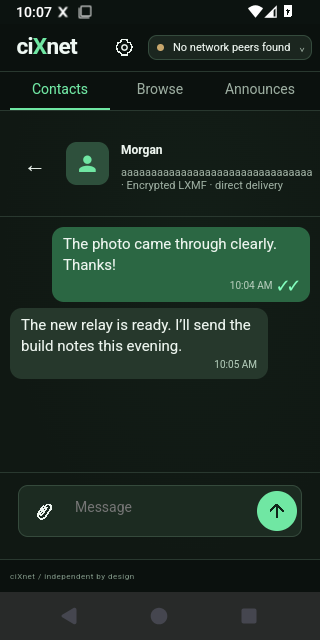

# ciXnet Reticulum Client

A free Reticulum client for Windows and Android, with messaging, network browsing and support for connections that come and go.

## Download 0.1.1

- **[Download for Android — APK](https://github.com/Thorian/cixnet-reticulum-client/releases/download/v0.1.1/ciXnet-debug.apk)**
- **[Download for Windows — ZIP](https://github.com/Thorian/cixnet-reticulum-client/releases/download/v0.1.1/ciXnet-windows.zip)**
- [Release notes and checksums](https://github.com/Thorian/cixnet-reticulum-client/releases/tag/v0.1.1)

Android: allow installation from your browser. Existing previews can update with this APK. Windows: extract the whole ZIP and run `ciXnet.exe`; Microsoft Edge WebView2 is required. Linux: follow the source instructions below.



The screenshot uses demonstration messages. Read the [user guide](manual/MANUAL.md) for setup and everyday use.

## What it does

- Direct LXMF messaging, saved conversations and message search.
- Files, images and photos, with optional image reduction before sending.
- Multiple identities, editable names and symbols, key import/export and contact blocking.
- Several propagation mailboxes, persistent retries and recipient receipts.
- Standard NomadNet pages and separate NomadPL HTML browsing.
- DNS authorities with locally assigned suffixes, persistent bookmarks and an external-browser bridge.
- Encrypted phone pairing so the desktop can use the phone's existing history.
- A saved radio-station directory that learns discovery announces and sorts candidates by location.

Messaging uses standard Reticulum and LXMF protocols. ciXnet's additional services use their own application namespaces.

## Platforms

| Platform | Current state |
| --- | --- |
| Windows | Portable desktop preview. Uses Edge WebView2 and a separate receiver process. Windows Hello can lock the identity interface. |
| Android 8+ | Testing APK for ARM64 and x86-64. Foreground receiver, message notifications, camera support and on-demand location for station sorting. |
| Linux | Source and desktop build instructions available. A packaged Linux release still needs testing. |

Minimise the Windows app to keep receiving; quitting stops its receiver. On Android, the receiver can continue after the interface closes. Force-stop stops reception until the app is reopened. Neither version starts automatically after reboot.

## Run from source

Use Python 3.12 and Git. Create a virtual environment in this folder:

```text
python -m venv .venv
```

Activate it on Windows:

```powershell
.venv\Scripts\Activate.ps1
```

Or on Linux:

```sh
. .venv/bin/activate
```

Install the dependencies and start the browser preview:

```text
python -m pip install -r requirements.txt
python server.py
```

Open **http://127.0.0.1:8765/**. The JavaScript bundle is included, so Node.js is needed only when changing the frontend. Companion libraries are pinned to Git revisions in requirements.txt.

The preview stores its data under `%LOCALAPPDATA%/cixnet-preview` on Windows and `~/.local/share/cixnet-preview` on Linux. Use `--data PATH` for a separate directory. The packaged desktop uses its own `ciXnet` data folder; it does not automatically import development data.

For a source checkout of a dependency, use `--reticulum-source`, `--lxmf-path`, `--retdns-source` or `--nomadpl-source`. The corresponding environment variables are documented in [DEVELOPMENT.md](DEVELOPMENT.md).

## Build and test

```text
python -m pip install -r requirements-dev.txt
python -m unittest discover -s tests -v
npm ci
npm test
npm run build
```

Tests create temporary identities and loopback connections. They do not need your normal profile data or a public gateway. Native device checks are separate from the automated suite.

- [Windows and Linux packaging](DESKTOP.md)
- [Android build and phone checks](ANDROID.md)
- [Development guide](DEVELOPMENT.md)
- [Phone pairing](PHONE_PAIRING.md)
- [Radio station directory](STATIONS.md)
- [Contributing](CONTRIBUTING.md)

## Current limits

The client is a development preview. Android fingerprint unlocking, automatic radio scanning/tuning and automatic start after reboot are not implemented. Long idle periods and battery use still need more phone testing.

The public gateway is available at `gw.cixnet.org:4242`. Fresh installs include its propagation mailbox and the ciXnet DNS authority under `.cix`. You can change or remove these defaults. The station-list HTTPS and Reticulum endpoints also need deployment. The client does not scrape RMAP; our server-side compiler is prepared for a weekly update, pending data redistribution agreement.

Identity keys and message storage are not encrypted by ciXnet. Windows Hello locks access through the interface, not the files. An exported `.identity` contains a private key and does not include conversation history. Keep the local client API on loopback; use phone pairing for approved remote access.

## Licenses and credits

Original ciXnet code and artwork use the [MIT license](LICENSE). Reticulum and LXMF use the Reticulum License; dependencies and bundled assets keep their own terms. See [THIRD_PARTY_NOTICES.md](THIRD_PARTY_NOTICES.md) and the in-app About page.

ciXnet uses OpenAI’s Codex AI assistance in development, debugging and testing. AI work doesn’t replace human oversight.
