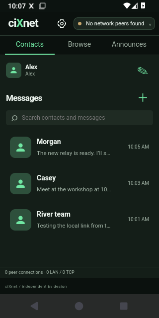
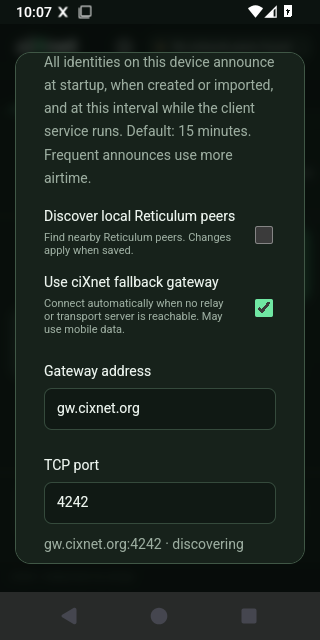
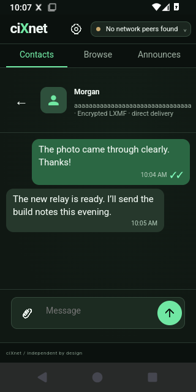
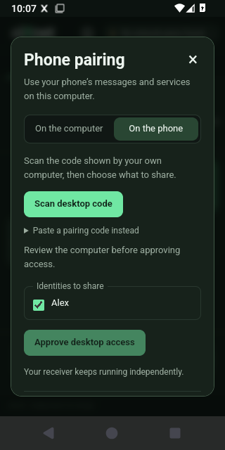

# ciXnet

## User guide

**Messages, local networks and independent services**

ciXnet is a messaging and browsing client for Reticulum. Connect over a local network, a radio link or an Internet gateway. For delayed delivery, choose propagation servers that can hold messages until the recipient collects them.

This guide covers the development preview as of **16 November 2026**. Screenshots show the actual Android interface with demonstration identities and conversations; they do not show a live public gateway or private user data.

To get started, create an identity, check your connection and send a test message. Then add mailboxes if you need delayed delivery.

## Contents

1. [Install and get started](#install-and-get-started)
2. [Windows desktop guide](#windows-desktop-guide)
3. [Your identity](#your-identity)
4. [Find a connection](#find-a-connection)
5. [Contacts and conversations](#contacts-and-conversations)
6. [Files, images and photos](#files-images-and-photos)
7. [Messages when connections disappear](#messages-when-connections-disappear)
8. [Browse the network](#browse-the-network)
9. [Names, DNS and bookmarks](#names-dns-and-bookmarks)
10. [Use your phone from a computer](#use-your-phone-from-a-computer)
11. [Android background reception](#android-background-reception)
12. [Troubleshooting](#troubleshooting)
13. [Privacy, backups and limits](#privacy-backups-and-limits)
14. [Project and credits](#project-and-credits)

## Install and get started

### Android

The current testing package is called **ciXnet-debug.apk**. Download it from the project and open it on your phone. Android may ask you to allow installation from the application opening the file. The preview requires Android 8 or later and includes ARM64 and x86-64 builds.

This is a development build, signed with a development key. Back up your identity before replacing or removing an installation. Keep the existing app installed when applying a compatible update: uninstalling can erase its private data.

On Android 13 or later, allow notifications if you want message alerts. Receiving and storing messages does not depend on granting that permission, but visible alerts do.

### Windows and Linux

Windows has a packaged desktop preview. Keep the packaged application folder intact and launch **ciXnet.exe**. The shared source supports a Linux development setup; a finished Linux installer is not supplied by this guide.

For source builds and runtime details, see [DESKTOP.md](../DESKTOP.md) and [DEVELOPMENT.md](../DEVELOPMENT.md).

### Your first conversation

1. Create an identity, or import an identity file you already own.
2. Select that identity to enter the client.
3. Open the connection indicator and check the available interfaces.
4. Find a messaging contact in **Announces**, or obtain their LXMF messaging address directly.
5. Open the contact’s conversation and send a short test message.
6. Ask them to reply. Check both directions before relying on the connection.



*Figure 1. Contacts and conversations share one tab. The most recent activity appears first.*

## Windows desktop guide

The Windows app runs from its extracted folder. Use it with its own identities, or pair it with your phone to access the phone’s conversations.

### Open the portable application

1. Download the Windows package and extract the whole folder.
2. Leave **ciXnet.exe**, **ciXnet-service.exe**, the bundled folders and supporting files together. Copying only the main executable is not enough.
3. Launch **ciXnet.exe**. The package includes Python; you do not need to install Python separately for this build.
4. Windows needs the [Microsoft Edge WebView2 runtime](https://developer.microsoft.com/en-us/microsoft-edge/webview2/). If the window cannot initialise, check that runtime before changing your network settings.
5. Create or import an identity, or choose **Pair with phone** to use the phone's client instead.

This preview has no installer or automatic updates and is not code-signed. If Windows reports an unknown publisher, check where the package came from before running it.

### Keep receiving on your computer

**Minimise the window to keep receiving.** Closing or quitting the desktop application shuts its receiver down. This preview has no tray mode and does not install a background Windows service or automatically start with Windows.

The receiver runs separately from the window while the application is open. Locking an identity's interface does not stop reception or mailbox synchronisation. Sleeping or shutting down the computer interrupts networking; leave messages queued for later or use configured propagation mailboxes.

### Connect on a local network

Open the connection indicator and **Settings** to inspect or configure LAN and TCP interfaces. A second ciXnet/Reticulum instance can occupy Windows' local discovery port. If that happens, ciXnet starts with local discovery disabled for that session and shows a warning. TCP connections still work. Your saved discovery setting does not change.

Close the conflicting instance and restart ciXnet to restore discovery. For phone pairing, use the offered LAN firewall allowance rather than disabling the firewall.

### Protect the identity interface with Windows Hello

On a supported Windows installation, identity protection uses [Windows Hello](https://learn.microsoft.com/en-us/windows/security/identity-protection/hello-for-business/) through [Yubico python-fido2](https://github.com/Yubico/python-fido2). The prompt can use fingerprint, face or PIN according to your device and Windows configuration.

1. Back up the identity key before enabling protection.
2. Select the identity and open its protection controls in **Settings**.
3. Choose **Enable Windows Hello** and follow the Windows prompt.
4. Use **Lock identity**, or switch identities, to lock the interface.
5. Unlock through Windows Hello when you next need access. Protected identities also start locked after a restart.

This protects access through the running interface. It does **not** encrypt saved identity keys, messages or attachments on disk. If the associated Hello credential is lost, the interface cannot unlock using it; an exported key is your separate recovery copy, without message history.

### Send a webcam photo

Open the paperclip menu in a conversation and choose **Take photo**. If a webcam is available, capture a photo, then choose **Retake** or **Use photo**. Using the photo adds it to your draft; review it, optionally reduce its size, and send when ready. Closing capture releases the camera. File/image selection remains available if webcam capture is unavailable.

### Find your saved data

By default, Windows stores the client data in:

```text
%LOCALAPPDATA%\ciXnet
```

Paste that path into File Explorer's address bar to locate the folder. Your messages and keys are stored here, separate from the application files. The development browser preview uses its own selected data folder and is not automatically imported into the desktop package.

Only one desktop instance can use a particular data folder at a time. If you launch with `--data PATH`, ciXnet uses that folder’s identities and history.

For troubleshooting, **receiver.log** lives in the data folder, with rotation at 2 MiB and two backups. Logs may contain identifying information: review and redact them before sharing. Embedded-browser state lives in the **webview** subfolder. Never post the whole private data folder as a bug report.

### Update and back up

1. Export important identity keys to a private backup location.
2. Quit ciXnet before replacing application files or copying its private data folder.
3. Extract the complete new package; keep its supporting files together.
4. Start the updated application and confirm the expected identities and history are present.

An identity export backs up the key only. You can also copy the complete data folder while ciXnet is closed. Full-data restoration has not yet been tested, and there is no built-in backup tool. Both copies contain private information.

### Windows, Android and Linux at a glance

| Behaviour | Windows preview | Android preview | Linux |
| --- | --- | --- | --- |
| Runtime | Bundled Python, pywebview and Edge WebView2 | Python through Chaquopy; Android System WebView | Source/build path uses GTK and WebKitGTK; release GUI verification pending. |
| Receive with interface hidden | Minimise; keep application open. | Foreground receiver can continue after closing the interface. | Desktop lifecycle is intended to follow the shared launcher. |
| Quit / force-stop | Quitting stops receiver. | Force-stop stops reception until reopened. | Packaged behaviour requires target-platform testing. |
| Identity interface protection | Windows Hello on supported devices. | Fingerprint integration unfinished. | No equivalent native integration provided. |
| Startup after reboot | Not automatic. | Not automatic. | Not supplied by this preview. |
| Use phone's existing history | Pair with phone. | Authorise the paired computer. | Requires verified Linux desktop runtime. |

## Your identity

Your identity contains the keys that identify you on the network. Its nickname, public name and symbol make it easier to recognise.

### Nickname, display name and symbol

Use identity management to change your local nickname, public display name and symbol. A local nickname helps you distinguish identities on this device. The public display name is shared in messaging announces. Changing those details preserves the identity’s keys and messaging address.

You can keep multiple identities. Select the intended identity before messaging or browsing: conversation history and bookmarks belong to that identity. DNS authority assignments are shared by identities on the same client.

### Export and import

Export saves a raw **.identity** file. Treat that file as a private key: someone who obtains it can impersonate that identity. Keep it somewhere private and backed up.

Import restores the key into the client. It does **not** restore old messages, attachments, nicknames, bookmarks or settings. Identity export is not a complete application backup.

Do not publish identity files in screenshots, bug reports or GitHub repositories. Android fingerprint unlocking is not implemented in this preview. ciXnet does not currently encrypt identity and message storage itself.

## Find a connection

Open the connection indicator to see your interfaces and gateway status. A connected peer may only give you a route to that device.

| Connection | What it gives you |
| --- | --- |
| Nearby peer | A connection to another Reticulum participant; it may only reach that participant. |
| Relay or transport server | A route that may connect you to other participants and services. |
| Internet fallback gateway | A Reticulum TCP connection over available Internet access. |
| LXMF propagation server | A mailbox for later message collection; configure these separately. |

### Local discovery

Reticulum’s AutoInterface uses IPv6 for local discovery. Devices need a compatible local network and working multicast. Guest Wi-Fi, device isolation, firewall rules and disabled IPv6 can prevent discovery even when ordinary web browsing works.

If discovery fails, a configured TCP interface can provide an explicit connection. In **Settings**, enter the reachable server’s address and TCP port and save. Both devices still need a network path to that server.

### Automatic Internet fallback

The default target is **gw.cixnet.org**, TCP port **4242**. In **Settings**, the fallback can be disabled or its target changed.



*Figure 2. The default gateway is editable. This screenshot demonstrates configuration, not public service availability.*

The client allows a short discovery period, then attempts the fallback if no reachable relay or transport server is established. A nearby ordinary peer does not prevent fallback. The client waits longer between failed attempts.

On Android, the implementation can request cellular Internet when Wi-Fi supplies only a local network, while retaining local Wi-Fi interfaces. Switching to mobile data and its effect on battery use still need phone testing. Your usual data charges apply.

**Public gateway:** `gw.cixnet.org:4242` is available. Fresh installs include the propagation node and `.cix` DNS authority. These settings can be changed or removed.

### Announces

Announces let you discover contacts and services. Open a messaging announce to start a conversation, or a DNS announce to assign its server a suffix.

Identities announce at receiver startup and every **45 minutes** by default. The interval is configurable. Recent announce ages use seconds for the first five minutes. A device may have disconnected since its last announce.

## Contacts and conversations

**Contacts** combines your contacts and message threads, ordered by recent activity. Open a conversation to see its saved history and compose a reply.



*Figure 3. The composer contains the attachment menu and send arrow. Demonstration messages illustrate the layout.*

Identity disclosure in Browse is remembered for the whole destination node, separately for each local identity. Pages and form submissions on that node use the saved choice; other nodes remain separate.

### Search old messages

Use the conversation search to look for a contact or words from saved messages. Search includes stored history beyond the messages currently loaded on screen. Open a result to navigate to the matching message.

### Understand delivery

The symbol beside an outgoing message shows its delivery state. On Windows, hover over it for its label.

| Symbol | Meaning |
| --- | --- |
| ◷ | Queued: saved locally, waiting for a route or retry. |
| ↑ | Sending: a transfer is in progress. |
| ✓ | Stored on relays: a mailbox accepted a copy; the recipient may not have it yet. |
| ✓✓ | Received by the recipient’s client. |
| ⊘ | Retries stopped. |
| ! | Delivery failed or an older interrupted send needs attention; check its label. |

Receipt means reception by the recipient’s client. It does not mean the person opened or read the conversation. Other clients may not support ciXnet’s additional propagated-message receipts.

### Block a contact

Click or tap the contact’s name or symbol in the conversation header to open its identity/announce details. Choose **Block** there. The same place offers **Unblock**.

Blocking applies to the selected local identity. Existing history remains available; pending outgoing retries to that contact are cancelled, and incoming messages from them do not trigger alerts. Blocking does not recall copies already transmitted.

## Files, images and photos

Use the **paperclip** inside the composer to choose a file, an image or **Take photo**. Review the draft before sending; taking a photo does not send it automatically.

### Reduce an image before sending

You can keep the original or reduce its longest edge to **640**, **1280** or **1920 pixels**. The preview reports the resulting size. Reduction creates a separate attachment and leaves your original untouched. Images are not enlarged, and the original is retained if conversion would make it larger.

Choose a smaller image for a slow link. A radio path can be much slower than the local Wi-Fi or Internet connection you normally use. Animated images become a still image when reduced.

### Attachment limits

The current limit is **eight attachments and 8 MiB total per message**. Attachments are saved with conversation history. The client previews PNG, JPEG, GIF and WebP images. Other files can be downloaded.

Disabling image display stops automatic preview loading in the interface. It does not remove the image bytes from an LXMF message already being received. Resumable transfers and per-byte progress are not available yet.

## Messages when connections disappear

Propagation servers act like mailboxes. A sender leaves a copy, and the recipient collects it later. A mailbox can be useful even if it is isolated and people only encounter it while passing through an area.

### Choose your mailboxes

In **Settings → Offline messaging**, add discovered propagation servers or paste their destination addresses, one per line. You can configure up to **eight**. Merely discovering a server does not select or trust it.

The default delivery mode attempts direct delivery and a copy to every reachable configured mailbox. Direct-only and relays-only modes are also available.

### Why send more than one copy?

Different mailboxes may serve disconnected networks. The recipient might reach only one of them. Acceptance by one mailbox therefore does not cancel the remaining copies.

The client continues until all configured mailboxes have accepted their copies, or the actual recipient confirms receipt. Receipt stops further pending copies; it cannot erase copies already left elsewhere. Duplicate copies retain the same signed message hash so they can be recognised as the same message.

### Collect incoming messages

Mailbox checks run every **five minutes** by default, with a configurable interval of **1–60 minutes** and a manual check action. An announce from a configured mailbox can trigger an earlier check if it has not been checked in the last minute. Repeated announces do not each start another check.

The receiver must remain running. An unreachable mailbox cannot be checked until a route becomes available.

### Queues and retries

Outgoing messages are saved before sending and survive receiver restarts. Retries back off from 15 seconds to 15 minutes. The queue is limited to **100 messages / 64 MiB**. Use **Stop retries** to cancel local pending work; already transmitted copies remain outside your control.

There is no automatic local queue expiry. Each propagation server sets its own retention policy, so an accepted copy is not a promise of indefinite storage.

## Browse the network

**Browse** opens network pages, discovered destinations and your saved bookmarks. The address bar includes navigation controls, a bookmark star and a person icon for optional identification to a site. The sidebar can be resized or collapsed.

### Saved radio stations

Open **Settings → Saved stations and radio profiles** to see radio stations the
client has learned or imported. Entries are kept across restarts. Enter latitude
and longitude, then choose **Sort by distance**, or tap **Use my location**. On Android, allow approximate or precise location when prompted. The button takes one location fix and shows its accuracy; it does not track you in the background. If permission is declined or location is unavailable, enter coordinates manually. Your
position is used by your client and is not sent to the directory website.

Each entry shows its frequency, bandwidth, spreading factor, coding rate, source
and last-heard time. Open **Radio profile** to see the configuration values.
Hearing an advertisement does not mean the station's radio is within range:
the announce may have reached you through an Internet connection or other nodes.

You can import a compiled JSON file, request an update from ciXnet, or enter a
Reticulum file address to fetch a list through the network. The public update
endpoints still need deployment. Failed imports leave the saved list intact.
The client never downloads RMAP's website itself.

Our weekly directory compiler includes stations first heard more than a calendar
month ago and last heard less than 24 hours before compilation. Locally learned
stations can appear immediately. New directory imports preserve those local
records. This version shows candidates; it does not automatically tune or scan
your radio. Existing manual network settings remain available.

### Standard NomadNet pages

Select a discovered NomadNet node or enter its destination address and path, for example:

```text
node_destination_hash:/page/index.mu
```

Replace the placeholder with the actual node destination. Standard pages use Micron, including its supported text styling, links and forms. Micron pages do not run HTML or JavaScript.

### NomadPL pages

NomadPL provides the separate HTML experience, including CSS, images, forms and JavaScript. For a configured DNS name, use an explicit address such as:

```text
nomadpl://home.cix/
```

NomadPL pages run separately from the client interface. Images, scripts and other resources hosted on the public web still need Internet access. JavaScript and AJAX are currently enabled.

### View source and open externally

**View source** uses the captured response for the current page. It does not fetch the page again. Saved source is temporary. If it is no longer available, the client tells you without fetching it again.

The external-browser action opens supported pages in an ordinary browser through ciXnet’s local bridge. Addresses can use destination-based or name-based `.localhost` hostnames. Keep ciXnet running: those addresses depend on its local gateway and are not public websites.

## Names, DNS and bookmarks

ciXnet’s DNS service maps readable names to Reticulum destinations. A suffix selects the DNS authority you chose locally; it is not a worldwide Internet domain registration.

### Assign a suffix

1. Open **Browse → DNS**, or the assignment action on an appropriate DNS announce.
2. Select the intended authority, or paste its destination address.
3. Assign a suffix such as **.cix** and save it explicitly.
4. Open a name that authority actually serves, such as **home.cix**.

Here, `home.cix` asks the authority assigned to `.cix` for `home`. A different device can assign the same suffix to a different authority. When sharing a name, also share which DNS server to use.

DNS assignments persist across restarts and apply client-wide. They are not carried inside an exported identity file. Saved DNS answers are reused until they expire.

### Save a bookmark

Open the desired page and use the **star inside the address bar**. Bookmarks keep the name you used, such as `nomadpl://home.cix/`. Opening one looks up the name again unless a saved DNS answer is still valid.

Bookmarks persist for the selected identity. If the star is unavailable, check whether the client can verify the current page location. Some pages prevent the address bar from tracking navigation. When that happens, bookmarking and source view are disabled.

## Use your phone from a computer

Pairing lets the desktop use your phone’s full client, including existing conversations, older messages and attachments.



*Figure 4. Review the requesting computer and selected identities before approving access. No live invitation is shown here.*

### Pair the devices

1. On the computer, choose **Pair with phone** from the identity screen or **Settings → Phone pairing**.
2. Select the computer’s reachable local IPv4 address and create an invitation.
3. If needed, use the offered LAN firewall allowance. Windows may request administrator approval.
4. On the phone, open **Phone pairing**, select **On the phone**, and scan the computer’s QR code.
5. Review the requesting computer. Select the unlocked identities you want to share and approve access.
6. On the computer, choose **Open phone client**.

The invitation expires after **five minutes** and can be used only once. Pairing uses encrypted, authenticated Reticulum Links. Devices need a working route between them; sharing a Wi-Fi name does not guarantee that guest-network isolation permits the connection.

### What stays on the phone?

The phone keeps receiving messages and stores the history. Its messaging private keys stay on the phone. Browsing, bookmarks, DNS and ordinary settings are available through the paired interface.

Create/import/export identities and change identity protection on the phone. Unlocking a protected identity also belongs on the phone. The desktop shows **Using phone** while connected.

Choose **Disconnect** to return to the computer’s local client. Revoke the computer on the phone to remove persistent access. Revocation stops further access; it cannot retract content someone already saw or captured.

## Android background reception

The receiver runs separately from the interface. Its persistent notification says **Receiver running · waiting for messages**. This service status should not create a launcher dot. Actual message alerts use a separate notification channel. Its notification includes a **Stop** action; opening ciXnet starts it again.

Message notifications omit message bodies and attachment names. Android’s notification and lock-screen settings determine whether and where an alert is shown. For vibration, open Android’s app notification settings for ciXnet, then **Incoming messages**, and enable vibration. Existing installations retain their previous channel settings after an update. Silent mode and Do Not Disturb still apply.

### Check your own phone

1. Exchange a message in each direction while both clients are open.
2. Lock the phone and ask the other client to send another message.
3. Confirm the alert appears and the message is present after unlocking.
4. Close and reopen the interface, then check that history remains.
5. Disconnect and reconnect Wi-Fi; confirm pending work resumes when a route returns.
6. Leave the phone idle for a longer period and review battery use.

Manufacturer battery restrictions and Android idle behaviour can delay networking. The preview uses wake and multicast locks, which cost power. We still need longer battery tests on real phones.

**Force-stop prevents reception until the app is reopened. Automatic start after reboot is not implemented.** Do not rely on an untested phone installation as your only urgent communication path.

## Troubleshooting

| Symptom | What to check |
| --- | --- |
| No local announces | Check both receivers are running, local IPv6/multicast, firewall rules and Wi-Fi device isolation. Try a known reachable TCP interface. |
| Peers appear, but a service cannot be reached | A peer is not necessarily a transport server. Inspect the route and the service’s actual destination. |
| Default gateway fails | Check Internet access, the hostname `gw.cixnet.org`, TCP port `4242`, and the gateway’s availability. |
| Message remains queued | Check the recipient address, known identity and available route. For delayed delivery, configure reachable propagation mailboxes. |
| Message says stored on relays | A mailbox has a copy; this does not establish recipient receipt. The recipient may still need to collect it. |
| No locked-screen alert | Check Android notification permission and lock-screen settings, receiver notification and manufacturer battery controls. |
| Messages seem missing | Select the same identity and installation/data directory. Importing a key does not restore history. |
| A `.cix` name fails | Check the assigned DNS authority and suffix, its reachability and whether it serves that record. |
| Bookmark seems missing | Check the selected identity. DNS assignments are shared; bookmarks are identity-specific. |
| External browser page stops working | Keep ciXnet running and reopen the page through its bridge. A `.localhost` URL is local to that device. |
| Pairing fails | Create a fresh invitation, check its expiry, the selected LAN address, firewall and device isolation; approve on the phone. |
| Source is unavailable | Its captured response may have expired or navigation may be unsynchronised. Source view intentionally avoids refetching. |

For a useful bug report, include your platform, app build, the action taken, expected result and actual result. Use demonstration data where possible. Remove private keys, pairing codes, API credentials and private message content before sharing diagnostics.

## Privacy, backups and limits

Reticulum supplies the underlying network security; LXMF supplies messaging. Encryption in transit does not protect an unlocked device or an exported identity file. Protect device access and backups.

| Item | Current behaviour |
| --- | --- |
| Identity export | Raw private key; no message history or settings. |
| Message storage | Persistent per identity; not encrypted by ciXnet itself. |
| Paired desktop | Approved remote access; displayed content can remain in browser memory/storage. |
| Block contact | Local identity policy; cannot recall already sent copies. |
| Gateway | Provides connectivity; not a guarantee of delivery or a propagation mailbox. |
| Public fallback | Available at `gw.cixnet.org:4242`; user-configurable. |
| Android biometrics | Not implemented. |
| Battery endurance | Requires longer physical-device testing. |

Keep the developer web preview on the local device. Do not expose its private client API to the Internet. Use the phone-pairing feature for remote access.

## Project and credits

ciXnet is a free software project built on Reticulum. Local-network guidance, mail, group chat and a curated library are planned alongside the client. Those services are not deployed yet.

ciXnet uses OpenAI’s Codex AI assistance in development, debugging and testing. AI work doesn’t replace human oversight.

Original ciXnet code and artwork are provided under the [MIT license](../LICENSE). Dependencies retain their own licenses. See [Third-party notices](../THIRD_PARTY_NOTICES.md) and the in-app **About** page for attribution and full bundled license texts.

### Network and page projects

- [Reticulum](https://reticulum.network/) ([source](https://github.com/markqvist/Reticulum)) — network stack; custom Reticulum License.
- [LXMF](https://github.com/markqvist/LXMF) — messaging protocol and library; its own Reticulum License notice applies.
- [NomadNet](https://github.com/markqvist/NomadNet) — standard page protocol and Micron interoperability reference. The NomadNet application is not bundled.
- [Sideband](https://github.com/markqvist/Sideband) — consulted for compatible LXMF appearance metadata; its application UI is not bundled.
- [retdns](https://github.com/Thorian/retdns) — companion name-resolution library, MIT.
- [NomadPL](https://github.com/Thorian/nomadpl) — companion HTML-page library, MIT.

### Interface, runtime and packaging

- [Material Design Icons](https://pictogrammers.com/library/mdi/) ([font source](https://github.com/Templarian/MaterialDesign-Webfont/tree/v7.4.47)) — bundled interface symbols, Apache-2.0.
- [Python](https://www.python.org/) — application runtime; Python Software Foundation license.
- [pywebview](https://pywebview.flowrl.com/) — desktop window integration, MIT.
- [Microsoft Edge WebView2](https://developer.microsoft.com/en-us/microsoft-edge/webview2/) — Windows web runtime; Microsoft's terms apply.
- [GTK](https://www.gtk.org/) and [WebKitGTK](https://webkitgtk.org/) — Linux desktop runtime components; retain their respective licenses.
- [Chaquopy](https://chaquo.com/chaquopy/) — Python integration for Android, MIT.
- [Android WebView](https://developer.android.com/reference/android/webkit/WebView) — device-supplied Android web runtime.
- [PyInstaller](https://pyinstaller.org/) — desktop packaging tool, GPL with its bootloader distribution exception.
- [Yubico python-fido2](https://github.com/Yubico/python-fido2) — Windows Hello integration; see bundled BSD and associated notices.
- [qrcode-generator](https://github.com/kazuhikoarase/qrcode-generator) — offline pairing QR generation, MIT.
- [jsQR](https://github.com/cozmo/jsQR) — QR decoding, Apache-2.0.
- [pySerial](https://github.com/pyserial/pyserial) — serial support included in the Android preview, BSD.

### Supporting libraries and development tools

- [cryptography](https://cryptography.io/), [CFFI](https://cffi.readthedocs.io/) and [pycparser](https://github.com/eliben/pycparser) — dependency notices apply where bundled; Android uses Reticulum's supported internal crypto provider in this preview.
- [SQLite](https://sqlite.org/copyright.html) — persistent local storage, public domain.
- [OpenSSL](https://www.openssl.org/legal/license.html) — applicable runtime/dependency notices are retained with distributions.
- [Prettier](https://prettier.io/), [esbuild](https://esbuild.github.io/) and [Ruff](https://docs.astral.sh/ruff/) — formatting, frontend bundling and code checks, MIT.

See the [third-party notices](../THIRD_PARTY_NOTICES.md) and license files included with each package for the full details. Dependencies vary by platform.

This application is independently developed and does not imply endorsement by upstream authors.
